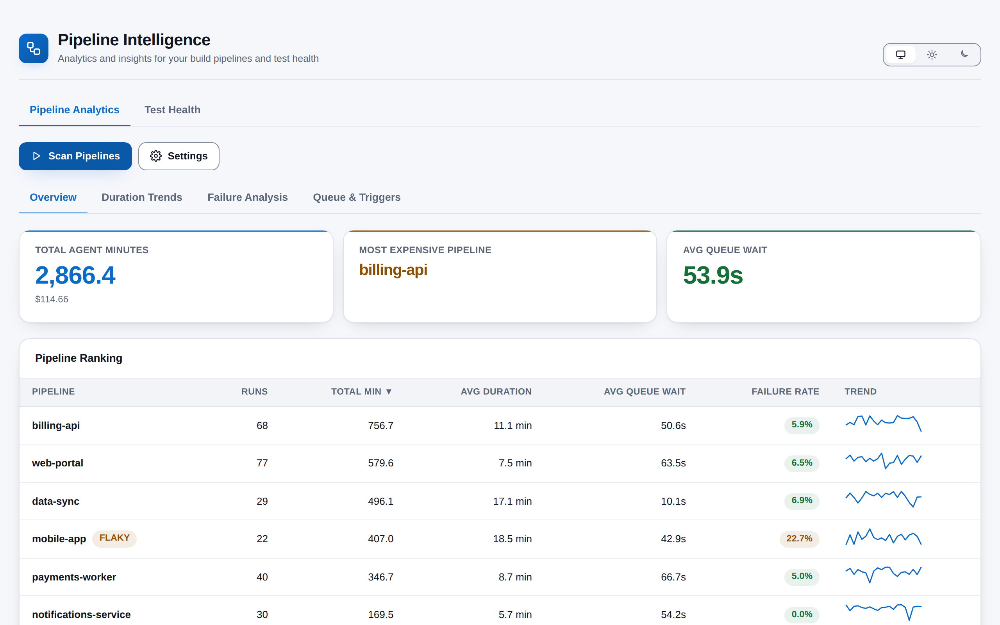
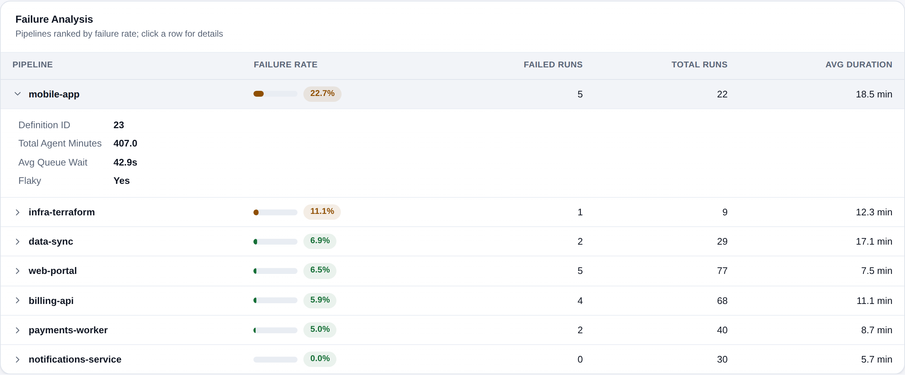
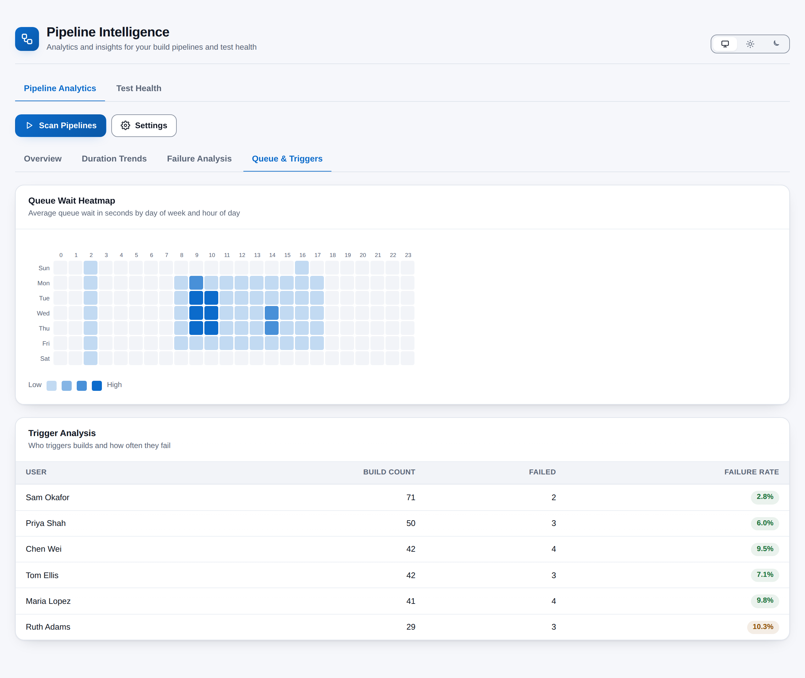
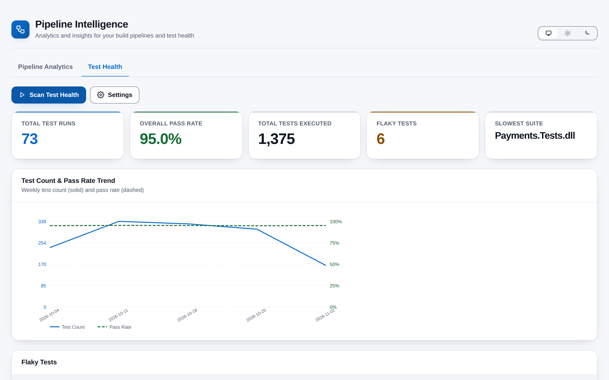
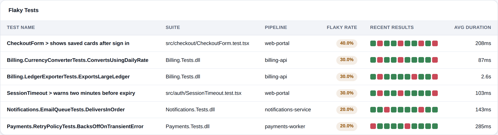

# Pipeline Intelligence

[](https://github.com/adam-wheater/azure-devops-pipeline-intelligence/actions/workflows/ci.yml)

An Azure DevOps extension that turns your build and test history into answers. It ranks every pipeline in a project by agent minutes, duration, queue wait and failure rate, shows when your agents are congested, detects flaky and slow tests, and does it all in the browser from a single hub under **Pipelines > Pipeline Intelligence**. It is built for the engineers and team leads who own CI/CD and keep asking the same question: *where are our build minutes and our reliability going?*



## Table of contents

- [Getting started](#getting-started)
- [Features](#features)
- [Screens](#screens)
  - [Pipeline Analytics tab](#pipeline-analytics-tab)
  - [Test Health tab](#test-health-tab)
- [How it works](#how-it-works)
- [Settings](#settings)
  - [Pipeline Analytics (`pipeline-settings`)](#pipeline-analytics-pipeline-settings)
  - [Test Health (`test-health-settings`)](#test-health-test-health-settings)
- [Rules and detection logic](#rules-and-detection-logic)
- [Scopes & permissions](#scopes--permissions)
- [Privacy](#privacy)
- [Troubleshooting and known limitations](#troubleshooting-and-known-limitations)
- [Development](#development)
- [Project structure](#project-structure)
- [Tech stack](#tech-stack)
- [Contributing](#contributing)
- [License](#license)

## Getting started

1. Install **Pipeline Intelligence** by publisher `adam-wheater` from the Visual Studio Marketplace (the listing carries the **Preview** flag). The scopes it asks for are listed under [Scopes & permissions](#scopes--permissions).
2. Open a project. The hub is contributed to the **Pipelines** hub group (`ms.vss-build-web.build-release-hub-group`, order 99) and appears last in the Pipelines menu as **Pipeline Intelligence**.
3. On first open there is no data: each tab loads its settings (defaults when none are saved) and waits for you to press **Scan Pipelines** or **Scan Test Health**. Scans are not cached between visits.
4. Open **Settings** on either tab, adjust the time period and thresholds, and press **Save Settings**. Saved values apply to everyone in the organisation on their next visit.

## Features

- **Cost tracking** -- Sums agent minutes across every completed build in the period, prices them with a configurable cost-per-minute rate and names the most expensive pipeline.
- **Pipeline ranking** -- A sortable table ranking every pipeline by runs, total minutes, average duration, average queue wait and failure rate, with an inline sparkline of recent durations and a `FLAKY` pill for inconsistent pipelines.
- **Duration trends** -- An SVG line chart of the last 20 build durations for any pipeline you pick, with grid lines, axis labels and a tooltip on every point.
- **Failure analysis** -- Pipelines ranked by failure rate with a tone-coded bar and percentage pill, expandable to show definition ID, total agent minutes, average queue wait and flaky status.
- **Queue wait heatmap** -- A 7x24 day-of-week by hour-of-day SVG heatmap of average queue wait, shaded on a four-step opacity ramp of the accent colour, with a tooltip per cell.
- **Trigger analysis** -- Who requests builds, how many, how many failed and the per-user failure rate.
- **Flaky test detection** -- Tests whose recent results mix passes and failures inside a configurable sliding window, with a colour- and title-labelled strip of recent outcomes.
- **Pipeline names on tests** -- Each test run and flaky test names the pipeline whose build published it, looked up from the build id rather than shown under the run's own title.
- **Slowest tests** -- The 20 slowest tests whose average duration clears a configurable threshold, with average, maximum and run count.
- **Test trend chart** -- A dual-axis SVG chart of weekly test count (solid) and pass rate (dashed), bucketed by local calendar week.
- **Test run history** -- The 50 most recent test runs with pass / fail / skip breakdowns and a tone-coded pass-rate pill.
- **Cancellable scans** -- Every scan runs under an `AbortController`; **Cancel** stops the next request, discards late pages and never writes a stale result into the UI.
- **Paged, capped fetching** -- Test runs and results are walked page by page with hard caps, so a mis-paginating server can never loop forever.
- **Persistent settings** -- Time period, cost per minute, queue wait threshold, flaky window size and slow-test threshold are saved through the Azure DevOps Extension Data Service and reloaded on the next visit.
- **Theme follows Azure DevOps** -- Light, dark and high contrast come from the host's `themeApplied` event, with a header toggle to pin light or dark; the toggle hides when a high-contrast theme or OS forced colours are active.
- **WCAG AA contrast** -- Every text / background and UI / surface pair in both palettes is audited to 4.5:1 and 3:1, and every colour cue is accompanied by text (pill labels, tooltips, `aria-label`s).

## Screens

The hub is one page: a header with the brand mark, title, subtitle and the theme toggle (Azure DevOps, Light or Dark), and two tabs. **Pipeline Analytics** reads completed builds. **Test Health** reads test runs and their results. Each tab has its own toolbar and **Settings** card, and its results appear below the toolbar after a scan. The screenshot at the top shows Pipeline Analytics after a scan.

### Pipeline Analytics tab

#### Toolbar, progress and errors

- **Scan Pipelines** (primary, with a play icon) starts a scan; while running it reads **Scanning...**, shows a spinner and is disabled.
- **Cancel** (stop icon) appears only while a scan is running. It aborts the controller and hides the progress bar.
- **Settings** toggles the settings card and flips to **Hide Settings** (`aria-expanded` tracks the state).
- The progress bar (`role="progressbar"`) shows the current stage message and `n / 100`. Stages: "Fetching build definitions..." (5), "Processing build data..." (30), "Computing pipeline statistics..." (50), "Building analytics..." (70), "Analysis complete" (100).
- Errors other than a cancel appear in a dismissible red banner (`role="alert"`). Starting a new scan clears the banner and the previous result.

Once data exists, four sub-tabs appear: **Overview**, **Duration Trends**, **Failure Analysis**, **Queue & Triggers**.

#### Overview: cost summary cards

| Card | Value | Tone |
|------|-------|------|
| **Total Agent Minutes** | Sum of `totalMinutes` across pipelines, formatted with up to one decimal. If `costPerMinute > 0`, the hint shows `$<minutes x rate>` to two decimals. | Accent |
| **Most Expensive Pipeline** | Name of the pipeline with the highest total minutes; `N/A` when there are no pipelines. | Warn |
| **Avg Queue Wait** | Mean of the per-pipeline average queue waits, in seconds to one decimal. | Danger when > 300 s, otherwise success |

#### Overview: pipeline ranking table

Sorted by **Total Min** descending by default. Click a header to sort by that column (descending first), click again to flip; ties are broken by definition ID so the order is stable. The active header exposes `aria-sort`.

| Column | Definition |
|--------|------------|
| **Pipeline** | Definition name, bold, with a `FLAKY` warn pill when the pipeline is flagged (see [rules](#rules-and-detection-logic)). |
| **Runs** | Completed builds in the period after exclusions. |
| **Total Min** | Sum of `(finishTime - startTime)` in minutes over builds that have both timestamps. |
| **Avg Duration** | Total minutes / builds with both timestamps, shown as `x.x min`. |
| **Avg Queue Wait** | Mean of `(startTime - queueTime)` in seconds over builds that have both, shown as `x.xs`. |
| **Failure Rate** | `builds with result Failed / Runs`, as a percentage pill. Success <= 10 %, warn 10-30 %, danger > 30 %. |
| **Trend** | Sparkline of the 20 most recent build durations, oldest on the left; `--` when fewer than two. |

Empty state: a single muted row, "No pipeline data available".

#### Duration Trends

A **Select pipeline for trend** dropdown (defaults to the first pipeline returned) drives an SVG line chart titled `Duration Trend - <pipeline>`:

- Plots the same last-20 durations as the sparkline, in minutes, with six dashed grid lines, a y-axis labelled **Minutes** and an x-axis labelled **Build Number** (the index 1..n within the sample, not the Azure DevOps build number).
- Each point is a circle with a tooltip `Build <n>: <x.x> min`; the chart has `role="img"` and an `aria-label` summarising count, min and max.
- Fewer than two durations shows "Not enough data for trend chart". A scan with no pipelines shows "No pipeline data available. Run a scan first."

#### Failure Analysis



Pipelines sorted by failure rate descending, then name. Click a row (`aria-expanded`) to expand it.

| Column | Definition |
|--------|------------|
| **Pipeline** | Chevron + bold name. |
| **Failure Rate** | 60 px bar filled to the failure percentage, in the same success / warn / danger tone as the pill beside it. |
| **Failed Runs** | `round(failureRate x totalRuns)`. |
| **Total Runs** | Completed builds counted for the pipeline. |
| **Avg Duration** | Average build duration in minutes. |

The expanded row lists **Definition ID**, **Total Agent Minutes**, **Avg Queue Wait** and **Flaky** (Yes / No). Empty state: "No failure data available".

#### Queue & Triggers: queue wait heatmap



Average queue wait in seconds for every day-of-week (Sun-Sat rows) by hour-of-day (0-23 columns) combination, using the **browser's local time** of each build's `queueTime`.

- **Colour**: cells are filled with the theme accent at one of four opacities, 0.25 / 0.5 / 0.75 / 1.0, chosen by `value / max` in the bands < 0.25, < 0.5, < 0.75 and >= 0.75. Cells with no builds are filled with the alternate surface colour at full opacity.
- **Text**: every cell has a tooltip `<Day> <h>:00 - Avg wait: <x.x>s`, and the SVG has an `aria-label`. A Low-to-High legend of the four swatches sits under the chart (decorative, `aria-hidden`).

#### Queue & Triggers: trigger analysis

| Column | Definition |
|--------|------------|
| **User** | `requestedFor.displayName`, falling back to the unique name, then "Unknown". Rows are keyed by `requestedFor.uniqueName` (or id). |
| **Build Count** | Builds requested by the user in the period. |
| **Failed** | Those with result `Failed`. |
| **Failure Rate** | `Failed / Build Count` as a pill with the same success / warn / danger thresholds as the ranking table. |

Sorted by build count descending. Empty state: "No trigger data available".

### Test Health tab



The toolbar and progress bar behave as on the Pipeline Analytics tab; the primary button reads **Scan Test Health**. Progress stages: "Fetching test runs..." (5), "Processing test runs..." (20), "Fetching test results..." (40), "Processing test results (i/n)..." (40-80), "Detecting flaky tests..." (85), "Finding slowest tests..." (90), "Computing trends..." (95), "Analysis complete" (100). Results render in one column: cards, trend chart, flaky tests, slowest tests, run history.

#### Test summary cards

| Card | Value | Tone |
|------|-------|------|
| **Total Test Runs** | Runs completed inside the period. | Accent |
| **Overall Pass Rate** | `results with outcome Passed / all results fetched`, one decimal. | Success >= 90 %, otherwise warn |
| **Total Tests Executed** | Count of individual test results fetched. | Neutral |
| **Flaky Tests** | Number of flaky tests detected. | Success when 0, otherwise warn |
| **Slowest Suite** | `suiteName` of the slowest test; `N/A` when none clears the threshold. | Neutral |

#### Test count & pass rate trend

An SVG chart titled **Test Count & Pass Rate Trend** with the hint "Weekly test count (solid) and pass rate (dashed)":

- Runs are bucketed by the **local** Sunday that starts their week (`localDateKey`, `YYYY-MM-DD`), sorted ascending.
- **Test count** is the sum of `totalTests` per week (solid line, chart series 1, left axis in the same colour). **Pass rate** is `sum(passedTests) / sum(totalTests)` (dashed line, success colour, right axis 0-100 %).
- X labels are rotated 30 degrees; with more than 10 weeks only every `ceil(n / 8)`th label is drawn. An in-chart legend names both series.
- Fewer than two weeks shows "Not enough data for trend chart".

#### Flaky tests



| Column | Definition |
|--------|------------|
| **Test Name** | `automatedTestName` (falls back to `testCaseTitle`), bold. |
| **Suite** | `automatedTestStorage`, e.g. `Contoso.Tests.dll`; "Default" when absent. |
| **Pipeline** | The build definition that published the run, looked up from the run's build id; the run title if the build cannot be read. |
| **Flaky Rate** | `min(passes, fails) / (passes + fails)` within the window, as a warn pill. |
| **Recent Results** | One 14 px square per result in the window: success colour for pass, danger for fail, muted for skip. Each square has a `title`, and the strip has an `aria-label` listing the outcomes. |
| **Avg Duration** | Mean of non-zero `durationInMs`; shown as `x.xs` above 1,000 ms, otherwise `Nms`. |

Sorted by flaky rate descending. Empty state: "No flaky tests detected".

#### Slowest tests

Titled **Slowest Tests (Top 20)**.

| Column | Definition |
|--------|------------|
| **#** | Rank 1-20. |
| **Test Name** / **Suite** | As above. |
| **Avg Duration** | Mean of non-zero durations as a warn pill; formatted `x.x min` at >= 60 s, `x.xs` at >= 1 s, else `Nms`. |
| **Max Duration** | Largest observed duration, same formatting. |
| **Run Count** | Number of non-zero-duration results for the test. |

Sorted by average duration descending. Empty state: "No slow tests found above threshold".

#### Test run history

Titled **Test Run History**, hint "The 50 most recent test runs", sorted by completion date descending.

| Column | Definition |
|--------|------------|
| **Run Name** | `run.name`, "Unknown" when absent. |
| **Pipeline** | The run's build definition name, or the run title if the build cannot be read. |
| **Date** | `completedDate` as short month, day, hour and minute in the browser locale. |
| **Total** | `totalTests`. |
| **Passed** | `passedTests`, in the success colour. |
| **Failed** | `unanalyzedTests + failedTests`, in the danger colour when non-zero. |
| **Skipped** | `Total - Passed - Failed`, floored at 0, muted. |
| **Pass Rate** | `Passed / Total` as a pill: success >= 95 %, warn 80-95 %, danger < 80 %. |

Empty state: "No test run data available".

## How it works

```
   Azure DevOps host (iframe parent)
   ----------------------------------
   SDK.init() -> SDK.ready() ---- theme variables + "themeApplied" ----+
        |                                                              v
        |                                           ThemeProvider -> data-theme / data-contrast
        v
   IProjectPageService.getProject()  --> project name
        |
        +--> Pipeline Analytics tab                 +--> Test Health tab
        |    BuildRestClient.getBuilds(             |    TestRestClient.queryTestRuns(
        |      project, minTime, Completed)         |      project, 7-day span, top, token)
        |         |                                 |         |  100 per page, newest span first
        |         |                                 |         v
        |         |                                 |    BuildRestClient.getBuilds(buildIds)
        |         |                                 |      pipeline name per build, 100 ids a call
        |         |                                 |         |
        |         v                                 |         v
        |    PipelineDataService                    |    for each run (sequential):
        |      per-definition stats, flaky flag,    |      TestRestClient.getTestResults(
        |      trigger stats, 7x24 queue heatmap    |        project, runId, skip, top)
        |         |                                 |           1,000 per page, <= 20 pages
        v         v                                 v         v
   React components (Cards, Metrics, Pills, SVG charts)
        ^
        |  ExtensionDataService  (collection "pipeline-intelligence-settings")
        +--- "pipeline-settings" document   <-- Save Settings on Pipeline Analytics
        +--- "test-health-settings" document <-- Save Settings on Test Health
```

1. **SDK init.** `src/PipelineIntelligenceHub/PipelineIntelligenceHub.tsx` calls `SDK.init()` then `SDK.ready()`, and only then mounts React inside `ThemeProvider`. If the handshake fails, a plain-DOM message ("Pipeline Intelligence could not connect to Azure DevOps. Refresh the page to try again.") and the error text are written with `textContent`.
2. **Theme.** `ThemeProvider` (`src/utils/theme.ts`) reads the CSS variables the SDK stamps on `:root`, listens for the `themeApplied` window event, `prefers-color-scheme` and `forced-colors` media queries, and writes `data-theme="light|dark"` and `data-contrast="high"` on `<html>`.
3. **Project context.** On **Scan**, each tab asks `IProjectPageService.getProject()` for the current project and fails with "Could not determine the current project." if none is returned.
4. **Pipeline Analytics fetch.** `PipelineDataService.fetchPipelineData` makes one `BuildRestClient.getBuilds` call filtered server-side to `minTime = now - timePeriodDays` and `BuildStatus.Completed`. No continuation token is followed. Builds are then filtered again client-side by `queueTime` and by `excludedDefinitionIds`.
5. **Test Health fetch.** `TestHealthService.fetchTestHealth` asks `TestRestClient.queryTestRuns` for the runs updated inside the period. That endpoint takes at most a 7-day span and 100 runs per page, so the period is walked in 7-day slices, newest first, following each slice's continuation token (up to 100 pages per slice). It keeps runs completed inside the period, looks up each run's pipeline name from its build (`BuildRestClient.getBuilds` by build id, 100 ids per call), then for each run pages through `TestRestClient.getTestResults` (1,000 per page, up to 20 pages = 20,000 results per run). Runs are processed one at a time; a run whose results cannot be read is skipped, but an abort is re-thrown and stops the scan.
6. **Cancellation.** Both services take an `AbortSignal`. `fetchAllPages` checks it before every request and after every response, and the tabs discard any result whose controller is no longer current. The `ConcurrencyLimiter` utility (max 5 in flight) is used only by `getStageBreakdown`, which the UI does not currently call.
7. **Computation.** Per-pipeline totals, averages and failure rates, the flaky-pipeline flag, per-user trigger stats and the 7x24 queue heatmap; per-test outcome windows for flaky detection, per-test duration stats for slow tests, weekly test-count and pass-rate buckets.
8. **Persistence.** `SettingsService` stores two documents in the Extension Data Service collection `pipeline-intelligence-settings`: `pipeline-settings` and `test-health-settings`. No scope type is passed, so the documents live in the extension's **Default (collection-wide)** scope: shared by everyone in the organisation, not per user and not per project. Missing fields fall back to the defaults; a failed read falls back to the defaults silently.

## Settings

Each tab has its own **Settings** card. Values are edited locally and written only when you press **Save Settings**, which also closes the card; a failed save surfaces in the error banner. Both documents are stored in the Extension Data Service collection `pipeline-intelligence-settings` in the Default (collection-wide) scope.

### Pipeline Analytics (`pipeline-settings`)

| Setting | Field | Default | Validation | Effect |
|---------|-------|---------|------------|--------|
| **Time Period (days)** | `timePeriodDays` | 30 | `min 1`; empty or 0 resets to 30 | `minTime` for `getBuilds` and the client-side `queueTime` filter. |
| **Cost per Minute ($)** | `costPerMinute` | 0 | `min 0`, step 0.01; empty resets to 0 | When > 0, the Total Agent Minutes card shows an estimated cost. |
| **Queue Wait Warning (seconds)** | `queueWaitWarningSeconds` | 300 | `min 0`; empty or 0 resets to 300 | Saved and reloaded, but **not read by the UI**: the Avg Queue Wait card uses a fixed 300 s threshold. |
| *(no UI)* | `excludedDefinitionIds` | `[]` | -- | Definition IDs removed before analysis. Honoured if present in the stored document, but there is no control to edit it. |

### Test Health (`test-health-settings`)

| Setting | Field | Default | Validation | Effect |
|---------|-------|---------|------------|--------|
| **Time Period (days)** | `timePeriodDays` | 30 | `min 1`; empty or 0 resets to 30 | The window `queryTestRuns` is asked for, in 7-day slices; runs whose `completedDate` is older are dropped. |
| **Flaky Window Size** | `flakyWindowSize` | 10 | `min 2`; empty or 0 resets to 10 | Number of most recent outcomes per test examined for flakiness. |
| **Slow Test Threshold (ms)** | `slowTestThresholdMs` | 30000 | `min 0`; empty or 0 resets to 30000 | Tests whose average duration is at or above this appear in Slowest Tests. |

The theme choice is separate: it is kept in the browser's `localStorage` under `pipeline-intelligence.theme` (`light` or `dark`; absent means follow Azure DevOps).

## Rules and detection logic

| Rule | Trigger | Shown as | Tune / disable |
|------|---------|----------|----------------|
| **Failure-rate tone** | rate > 30 % | danger pill / bar | Fixed thresholds in `failureTone` (`PipelineRankingTable.tsx`). |
| | 10 % < rate <= 30 % | warn | |
| | rate <= 10 % | success | |
| **Flaky pipeline** | >= 4 completed runs, >= 4 recorded durations, and 20 % <= failure rate <= 80 % | `FLAKY` pill; "Flaky: Yes" in Failure Analysis | Fixed in `computeFlakyPipelines`. |
| **Queue wait warning** | mean per-pipeline queue wait > 300 s | Avg Queue Wait card turns danger | Fixed at 300 s in `CostSummaryCards.tsx` (the saved setting is not applied). |
| **Heatmap band** | `cell / max` in [0, .25), [.25, .5), [.5, .75), [.75, 1] | accent at 25 / 50 / 75 / 100 % opacity | Fixed `RAMP_OPACITY` in `QueueWaitChart.tsx`. |
| **Flaky test** | >= 3 outcomes overall; within the last `flakyWindowSize` outcomes at least 2 are pass or fail, both occur, and `min(pass, fail) / (pass + fail) >= 0.1` | row in Flaky Tests, Flaky Tests card goes warn | `flakyWindowSize` setting; the 0.1 floor and 3-outcome minimum are fixed in `detectFlakyTests`. |
| **Slow test** | mean of non-zero durations >= `slowTestThresholdMs` | row in Slowest Tests (top 20) | `slowTestThresholdMs` setting; set it very high to effectively disable. |
| **Pass-rate tone (card)** | overall pass rate >= 90 % success, else warn | Overall Pass Rate card | Fixed. |
| **Pass-rate tone (run)** | >= 95 % success, >= 80 % warn, else danger | Pass Rate pill in run history | Fixed in `passRateTone`. |
| **High contrast** | OS `forced-colors: active`, or the host's primary text, secondary text and background are all pure black / white | palette switches to host colours, theme toggle hidden | Heuristic in `readHostTheme`; not configurable. |

## Scopes & permissions

| Scope | Used by |
|-------|---------|
| `vso.build` | `BuildRestClient.getBuilds`: the completed builds of every Pipeline Analytics scan, and the pipeline name of each run's build in every Test Health scan. `getBuildTimeline` is referenced by `getStageBreakdown`, which the UI does not call. |
| `vso.test` | `TestRestClient.queryTestRuns` and `TestRestClient.getTestResults` (every Test Health scan). |
| `vso.extension.data` | `IExtensionDataManager.getDocument` / `setDocument` for the two settings documents. |
| `vso.project` | No REST call needs it directly: the project name comes from the host `IProjectPageService`, and the Build and Test routes above are project-scoped. It is requested conservatively. |

Nothing is written to builds, tests or projects. The only write is to the extension's own data store.

## Privacy

Everything runs in the browser inside the Azure DevOps extension iframe. Build and test data are read from your organisation's Azure DevOps REST API and never leave it; there is no backend, no telemetry and no call to any third-party host.

What is stored:

| Data | Where | Scope |
|------|-------|-------|
| `timePeriodDays`, `excludedDefinitionIds`, `costPerMinute`, `queueWaitWarningSeconds` | Extension Data Service, collection `pipeline-intelligence-settings`, document `pipeline-settings` | Default scope: shared across the organisation |
| `timePeriodDays`, `flakyWindowSize`, `slowTestThresholdMs` | Same collection, document `test-health-settings` | Default scope: shared across the organisation |
| Pinned theme (`light` / `dark`) | Browser `localStorage`, key `pipeline-intelligence.theme` | This browser only |

Scan results are held in React state and discarded when you leave the page.

## Troubleshooting and known limitations

- **No per-stage costs.** The stage breakdown (`getStageBreakdown`, which reads build timelines with a 5-wide `ConcurrencyLimiter`) exists in the service but is not wired to any screen.
- **Queue Wait Warning setting has no effect.** It is saved and reloaded, but the Avg Queue Wait card compares against a fixed 300 seconds.
- **Excluded definition IDs cannot be edited in the UI.** The field is honoured if present in the saved document but there is no control for it.
- **Build fetch is a single request.** `getBuilds` is called once with `minTime` and no continuation token is followed, so for very busy projects the server's page limit may truncate the set. Builds queued before `minTime` but returned anyway are dropped client-side.
- **Test run paging is capped** at 100 pages x 100 = 10,000 runs per 7-day slice, and results at 20 pages x 1,000 = 20,000 per run.
- **Test results are fetched one run at a time.** A long period over a project with many runs can take minutes; use **Cancel** and shorten the period.
- **Tests are keyed by their automated test name alone.** Tests with the same name in different suites or pipelines are pooled for flaky and slow detection, and the Suite and Pipeline columns show the first one seen.
- **The newest week in the trend chart is usually partial**, so its test count dips even when nothing is wrong. Weeks start on Sunday.
- **Test runs with zero `durationInMs`** are excluded from slow-test averages and run counts; runs with no `completedDate` are dropped entirely.
- **"Failed" in run history includes `unanalyzedTests`**, and "Skipped" is derived as `total - passed - failed`, so it also absorbs any other outcome.
- **Trend order is the API's order.** Sparklines and the duration chart plot the last 20 durations in the order `getBuilds` returned them, without re-sorting by time, and the x-axis is a 1..n index rather than the real build number.
- **The queue heatmap is in the viewer's local time.** Each build is bucketed by the local weekday and hour of its `queueTime` in the browser viewing the page, so colleagues in different time zones see the same builds in different cells. Test-trend weeks are also local (Sunday-start) calendar weeks.
- **Pipeline names are the join key for the trend dropdown**; two definitions with the same name select the first match.
- **High-contrast detection is a heuristic**: it fires when the host's primary text, secondary text and background are all pure black or white, or when the OS reports forced colours. A custom host theme that happens to use pure values will be treated as high contrast and the theme toggle will hide.
- **Settings are organisation-wide.** The Extension Data Service documents are stored in the Default scope, so one user's Save changes the defaults for everyone.
- **"Could not determine the current project."** appears when the hub is opened outside a project context; open it from a project's Pipelines menu.
- **"Pipeline Intelligence could not connect to Azure DevOps."** means `SDK.init()` failed, usually because the extension iframe was blocked or the page was opened outside Azure DevOps; refresh the page.
- **Re-consent.** Adding scopes in a future version requires organisation administrators to re-authorise the extension in **Organization settings > Extensions**.

## Development

### Prerequisites

- Node.js 20 or later (`engines.node >= 20`) and npm.
- Install with `npm ci --legacy-peer-deps` (or `npm install --legacy-peer-deps`). The flag is required because of the Azure DevOps SDK and React 18 peer ranges, and CI uses it too.

### npm scripts

| Script | What it does |
|--------|--------------|
| `npm run build` | Production webpack build into `dist/`; `postbuild` runs `scripts/verify-bundle.js`, then `scripts/third-party-notices.js`. |
| `npm run build:dev` | Development build with source maps; CSS is still extracted to a file so the hand-written stylesheet link is exercised. |
| `npm run screenshots` | Builds the hub on sample data and saves the screenshots to `static/screenshots/` (see below). |
| `npm run verify:bundle` | Runs the bundle check on an existing `dist/`. |
| `npm run package` | `tfx extension create` -> `out/*.vsix`. |
| `npm test` | Jest, both projects, verbose. |
| `npm run lint` / `npm run lint:fix` | ESLint 9 flat config over `src/` and `tests/`. |
| `npm run format` / `npm run format:check` | Prettier over `src/**/*.{ts,tsx,css}` and `tests/`. |
| `npm run publish:marketplace` | `tfx extension publish` with `vss-extension.json`. |

### Run it locally with sample data

`demo/` builds the real hub against stand-ins for the Azure DevOps SDK and REST clients, filled with a fictional "Contoso" project. Use it to try the UI without an organisation, and to refresh the screenshots:

```sh
npm i --no-save playwright && npx playwright install chromium   # once
npm run screenshots
```

After that, open `demo/dist/PipelineIntelligenceHub/PipelineIntelligenceHub.html` in a browser to click around. `demo/api.ts` holds the sample data and `demo/shots.json` lists the screenshots; the other files in `demo/` are the same in every extension. Nothing in `demo/` ships in the package.

### `build.ps1`

`build.ps1` is the same script in every extension repository (it reads the product name from `vss-extension.json`) and runs the CI steps locally, in CI order:

1. `npm ci --legacy-peer-deps` (the same install as `ci.yml`).
2. `npm run lint` and `npm run format:check`.
3. `npm test`.
4. Bump the version in `vss-extension.json`, `package.json` and both root entries of `package-lock.json` (semver patch +1, e.g. 1.0.9 -> 1.0.10). If any later step fails, all three files are restored.
5. `npm run build` (including `postbuild` bundle verification) and `npm run package`.
6. Check that `out/adam-wheater.<id>-<version>.vsix` exists. If it does not, the script fails instead of reporting an older package.

| Parameter | Effect |
|-----------|--------|
| `-Version 1.1.0` | Release exactly this version instead of the patch bump. |
| `-NoBump` | Package the current version unchanged (cannot be combined with `-Version`). |
| `-SkipInstall` | Reuse the existing `node_modules`. |
| `-SkipTests` | Skip `npm test`. |
| `-SkipChecks` | Skip lint and format check (CI still enforces both). |

The committed version is 1.0.0. `.github/workflows/ci.yml` runs the same install, lint, format check, tests, build, bundle verification and packaging on Node 20, then uploads the `.vsix`.

### Tests

`jest.config.js` defines two projects sharing one `moduleNameMapper` (`@/` alias, CSS -> `styleMock.js`, SDK and API -> `tests/__mocks__`):

- **unit** -- `testEnvironment: node`, everything under `tests/` except `tests/components/`. Covers flaky-pipeline, trigger and queue analysis; flaky-test, slow-test and weekly-trend computation; `fetchAllPages` paging, caps and abort; `fetchRunsSince` 7-day slices, continuation tokens and boundary duplicates; `fetchTestHealth` result paging, pipeline names from the build definition and cancel propagation; `localDateKey`; that `BaseDataService` retries after a failed data-manager acquisition; and, in `tests/repo/npmScripts.test.ts`, repository guards: no npm script single-quotes an argument (cmd.exe does not strip single quotes, so such scripts break on Windows), every script `build.ps1` and CI call is defined, `build.ps1` and `ci.yml` both install with `npm ci --legacy-peer-deps`, and `build.ps1` is ASCII-only with no trailing whitespace after a line-continuation backtick. `tests/repo/packageContents.test.ts` asserts that no `.svg` file sits in any path `vss-extension.json` packages, because the Marketplace rejects them. The queue-analysis test builds its dates in local time, so it passes in any time zone.
- **components** -- `testEnvironment: jsdom` with `@testing-library/react` and `jest-dom` for `PipelineRankingTable` (headers, sorting, FLAKY pill, empty state) and `FlakyTestsTable` (names, rates, result strip, empty state).

### `scripts/verify-bundle.js`

Reads `HUB` from `webpack.config.js` and fails the build if any of these is true: the entry page is missing; the page references an asset that was not emitted; no stylesheet was emitted or an emitted stylesheet is not linked; `<HUB>.js` is not loaded; `#root` lacks `class="ax-root"`; the inline `<style>` sets padding on `#root`; a lazy chunk named in the webpack runtime map is missing; an emitted script still contains an AMD `define(`; or a `.d.ts` file leaked into `dist/`.

### Design system

- `src/styles/app.css` -- the shared stylesheet: `--ax-*` tokens on `:root` (accent, primary, surfaces, text, borders, success / warn / danger / info and their `-bg` variants, radii, fonts, easing), redefined under `:root[data-theme="dark"]` and mapped to the host variables under `:root[data-contrast="high"]`, plus the `.ax-*` component classes (shell, header, tabs, toolbar, cards, metrics, pills, bars, tables, forms, progress, banners, modal, gate, empty state).
- `src/components/ui.tsx` -- the primitives every screen is built from: `AppShell`, `ThemeToggle`, `Tabs`, `Button`, `Card`, `Pill`, `Metric`, `Banner`, `Progress`, `Skeleton`, `EmptyState`, `Gate`, `Modal`, `ConfirmDialog`, `Disclosure`, `SortHeader`, `ErrorBoundary` and the inline SVG icon set.
- `src/brand.tsx` -- `BRAND` (id, name, tagline) and `BrandGlyph`, the header mark drawn as inline SVG in the bundle. The only packaged icon file is `static/icon.png` (128x128 PNG): the Marketplace rejects `.svg` files in extension packages.

### Theming

The SDK's `init()` writes the host theme as CSS variables on `:root` and dispatches `themeApplied`, on load and on every later change. `ThemeProvider` re-reads them on that event (and on media-query and body-class changes), resolves light vs dark from the host background's relative luminance, detects high contrast, and sets `data-theme` and `data-contrast` on `<html>`. Resolution order: high contrast > the user's pinned light / dark choice > the Azure DevOps theme > body class > `prefers-color-scheme`. `useTheme()` exposes the same palette as a `ThemeColors` object for inline SVG, and `useThemeMode()` drives the header toggle. The host page stamps the stored choice before the bundle loads so a dark host never flashes light.

### Accessibility checks applied

Both palettes in `theme.ts` and `app.css` are audited for WCAG 2.1 AA (4.5:1 text, 3:1 UI and chart series). Tabs use `role="tablist"` / `role="tab"` / `aria-selected`; sortable headers expose `aria-sort`; the theme toggle uses `aria-pressed` with screen-reader-only labels; charts carry `role="img"` and descriptive `aria-label`s; the result strip has an `aria-label` and per-square `title`s; the progress bar is a `progressbar`; error banners are `role="alert"`; the modal primitive traps focus and restores it on close; `:focus-visible` rings are styled, and `prefers-reduced-motion` and `forced-colors` media queries are honoured. Colour is never the only cue: every tone has a label, pill text or tooltip beside it.

## Project structure

```
pipeline-intelligence/
├── src/
│   ├── PipelineIntelligenceHub/
│   │   ├── PipelineIntelligenceHub.html    # Host page: links the extracted CSS, stamps stored theme, #root.ax-root
│   │   └── PipelineIntelligenceHub.tsx     # Entry: SDK.init -> ready -> render <ThemeProvider><App/>
│   ├── brand.tsx                           # BRAND constants and BrandGlyph logo
│   ├── components/
│   │   ├── App.tsx                         # AppShell + top-level tabs (Pipeline Analytics / Test Health) in an ErrorBoundary
│   │   ├── ui.tsx                          # Shared primitives and icons
│   │   ├── PipelineAnalytics.tsx           # Scan / cancel / settings, progress, sub-tabs for the pipeline views
│   │   ├── CostSummaryCards.tsx            # Three Metric tiles (minutes and cost, most expensive pipeline, queue wait)
│   │   ├── PipelineRankingTable.tsx        # Sortable ranking table; exports failureTone
│   │   ├── Sparkline.tsx                   # Inline SVG polyline for the Trend column
│   │   ├── DurationTrendChart.tsx          # SVG line chart of the selected pipeline's durations
│   │   ├── FailureAnalysis.tsx             # Failure-rate table with expandable detail rows
│   │   ├── QueueWaitChart.tsx              # 7x24 heatmap on an accent opacity ramp
│   │   ├── TriggerAnalysis.tsx             # Per-user build / failure table
│   │   ├── TestHealth.tsx                  # Scan / cancel / settings, progress, test views
│   │   ├── TestSummaryCards.tsx            # Five Metric tiles for test health
│   │   ├── TestTrendChart.tsx              # Dual-axis weekly count / pass-rate chart
│   │   ├── FlakyTestsTable.tsx             # Flaky tests with recent-result strip
│   │   ├── SlowestTestsTable.tsx           # Top-20 slow tests
│   │   └── TestRunHistory.tsx              # 50 most recent runs
│   ├── models/
│   │   ├── interfaces.ts                   # Pipeline types, PipelineSettings, DEFAULT_PIPELINE_SETTINGS
│   │   └── testInterfaces.ts               # Test health types, TestHealthSettings, DEFAULT_TEST_SETTINGS
│   ├── services/
│   │   ├── BaseDataService.ts              # Lazily acquires the IExtensionDataManager; retries after failure
│   │   ├── SettingsService.ts              # Load / save the two settings documents
│   │   ├── PipelineDataService.ts          # getBuilds fetch, pipeline stats, flaky flag, triggers, heatmap
│   │   └── TestHealthService.ts            # queryTestRuns by 7-day span, getTestResults, flaky, slow, trend
│   ├── styles/
│   │   └── app.css                         # Design system tokens and .ax-* classes
│   └── utils/
│       ├── ConcurrencyLimiter.ts           # Promise concurrency cap (run / map)
│       └── theme.ts                        # Host theme detection, ThemeProvider, useTheme, useThemeMode
├── tests/
│   ├── __mocks__/
│   │   ├── azure-devops-extension-api.ts   # getClient mock with __setMockClient / __resetMockClients
│   │   ├── azure-devops-extension-sdk.ts   # SDK mock (init, ready, getService, getAccessToken, ...)
│   │   └── styleMock.js                    # Empty module for CSS imports
│   ├── components/
│   │   ├── FlakyTestsTable.test.tsx        # Rendering, formatting and empty state
│   │   └── PipelineRankingTable.test.tsx   # Headers, sorting, FLAKY pill, empty state
│   ├── repo/
│   │   ├── npmScripts.test.ts              # Windows-safe npm scripts, ASCII build.ps1, CI/script install parity
│   │   └── packageContents.test.ts         # No .svg file in any path the manifest packages
│   └── services/
│       ├── BaseDataService.test.ts         # Data-manager retry and sharing
│       ├── PipelineDataService.test.ts     # Flaky pipelines, trigger stats, queue analysis
│       ├── TestHealthService.pagination.test.ts  # fetchAllPages, fetchRunsSince, pipeline names, abort, localDateKey
│       └── TestHealthService.test.ts       # Flaky tests, slowest tests, weekly trend
├── demo/                                   # Runs the hub on sample data, for screenshots (never shipped)
│   ├── api.ts                              # Sample "Contoso" project behind stand-in REST clients
│   ├── shots.json                          # Which screenshots to take, and the clicks before each
│   └── kit.ts, sdk.ts, shots.js, webpack.config.js   # Same in every extension
├── scripts/
│   ├── third-party-notices.js              # Post-build: dist/THIRD-PARTY-NOTICES.txt from runtime dependencies
│   └── verify-bundle.js                    # Post-build dist/ sanity check
├── static/
│   ├── icon.png                            # Marketplace and hub icon (128x128 PNG; the only icon file, no .svg is packaged)
│   └── screenshots/                        # README and Marketplace screenshots (PNG, from npm run screenshots)
├── .github/workflows/ci.yml                # Lint, format, test, build, verify, package
├── LICENSE                                 # Proprietary source-available license
├── SECURITY.md                             # How to report a vulnerability privately
├── overview.md                             # Marketplace listing page
├── vss-extension.json                      # Extension manifest (hub, scopes, files)
├── webpack.config.js                       # Entry, CSS extraction, HTML copy, chunk layout
├── tsconfig.json                           # Strict TypeScript, @/ alias, no declarations
├── jest.config.js                          # unit (node) + components (jsdom) projects
├── eslint.config.js                        # ESLint 9 flat config + Prettier
├── .prettierrc.json                        # Prettier rules
├── .vsixignore                             # Files excluded from the .vsix
├── build.ps1                               # Shared build: npm ci, lint, format, test, bump 3 manifests, build, package
└── package.json                            # Scripts and dependencies
```

## Tech stack

| Category | Technology |
|----------|-----------|
| Framework | React 18 (`createRoot`) |
| Language | TypeScript 5, strict mode |
| Bundler | Webpack 5 with ts-loader, mini-css-extract-plugin, css-minimizer, copy-webpack-plugin |
| Testing | Jest 29, ts-jest, jest-environment-jsdom, @testing-library/react, @testing-library/jest-dom |
| Linting | ESLint 9 flat config, typescript-eslint, Prettier 3 |
| SDK / API | azure-devops-extension-sdk 4.x, azure-devops-extension-api 4.x (Build and Test clients, common host services) |
| Charts | Hand-written SVG; no charting library |
| Packaging | tfx-cli |

## Contributing

> This project is source-available, not open source. Bug reports and feature requests are
> welcome through GitHub Issues. Code contributions are accepted only by prior written
> agreement; anything you submit is licensed to the project owner under section 4 of the
> LICENSE.

## License

> Copyright © 2026 Adam Wheater. All rights reserved.
>
> This software is provided under a proprietary source-available license: you may read and
> audit the code and use the published extension, but you may not copy, modify, redistribute
> or republish it. See [LICENSE](LICENSE) for the full terms.
>
> Open source components bundled into the extension keep their own licenses. `npm run build`
> writes their notices to `dist/THIRD-PARTY-NOTICES.txt`, which ships inside the package.
