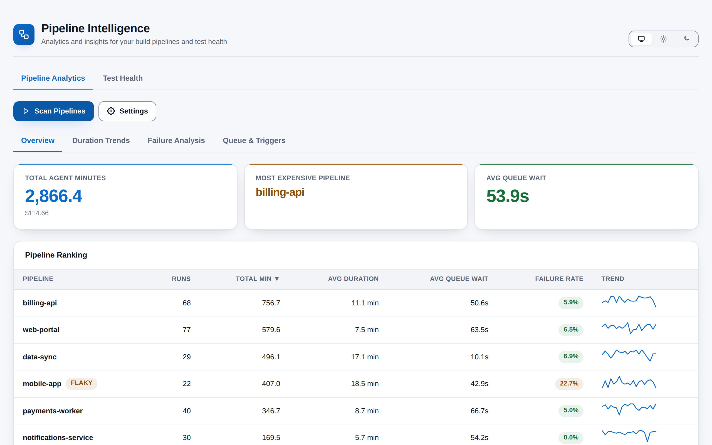
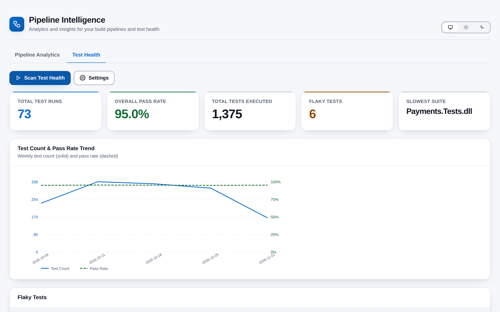

# Pipeline Intelligence

**Where are your build minutes and your reliability going?** Pipeline Intelligence answers that from inside Azure DevOps. It reads your project's completed builds and test runs, ranks every pipeline by cost, duration, queue wait and failure rate, shows the hours when your agents are congested, and finds the flaky and slow tests that quietly erode confidence in your CI. Everything runs in your browser, in a hub under **Pipelines > Pipeline Intelligence**.

## What you get

### Pipeline Analytics

- **Cost at a glance** -- total agent minutes for the period, priced with your own cost-per-minute rate, and the pipeline that consumes the most.
- **Pipeline ranking** -- a sortable table of every pipeline: runs, total minutes, average duration, average queue wait, failure rate and an inline duration sparkline, with a `FLAKY` marker for pipelines whose results swing between pass and fail.
- **Duration trends** -- a line chart of the most recent builds for any pipeline you pick.
- **Failure analysis** -- pipelines ranked by failure rate, with a bar and percentage for each and a click-to-expand row for the details.
- **Queue wait heatmap** -- a day-of-week by hour-of-day grid of average queue wait, shaded from light to solid so congestion windows jump out, with the exact seconds on hover.
- **Trigger analysis** -- who requests builds, how many, and how often theirs fail.

### Test Health

- **Summary cards** -- test runs, overall pass rate, tests executed, flaky-test count and the slowest suite.
- **Weekly trend** -- test count and pass rate side by side, week by week.
- **Flaky tests** -- tests whose recent results mix passes and failures inside a sliding window you control, with a strip of their latest outcomes.
- **Slowest tests** -- the twenty slowest tests above your threshold, with average and maximum durations.
- **Run history** -- the fifty most recent runs with pass, fail and skip counts.

### Built for the Azure DevOps UI

- Follows your Azure DevOps light, dark or high-contrast theme, with a toggle to pin light or dark.
- Every colour has a label beside it: pills, tooltips and legends never rely on colour alone, and both palettes meet WCAG AA contrast.
- Scans show their progress and can be cancelled at any time.

## How it works

1. Open **Pipelines > Pipeline Intelligence** in any project.
2. Press **Scan Pipelines** or **Scan Test Health**. The extension fetches the period's completed builds, or its test runs and their results, directly from your organisation's Azure DevOps REST API, with a progress bar you can cancel.
3. The numbers are computed in your browser: per-pipeline totals and failure rates, the queue heatmap, flaky and slow tests, weekly trends.
4. Open **Settings** to change the time period, cost per minute, flaky window or slow-test threshold, then **Save Settings**. Your choices are kept for the next visit.

## Permissions, in plain words

The extension asks to **read** your builds and test results, to **read** the current project, and to **store its own settings** in the Azure DevOps extension data store. It does not write to builds, pipelines, tests or work items, and it only queries the project you are looking at.

## Privacy

All analysis happens in the browser inside the Azure DevOps page. Build and test data never leave your Azure DevOps organisation, nothing is sent to any other service, and there is no telemetry. The only things stored are the settings you save (in the Azure DevOps Extension Data Service, shared across your organisation) and your theme preference (in your own browser).

## Requirements

- Azure DevOps Services, or Azure DevOps Server 2020 or later.
- Permission to read builds and test results in the project.

## Support

Report problems or request features through GitHub Issues: https://github.com/adam-wheater/azure-devops-pipeline-intelligence/issues

## License

Copyright © 2026 Adam Wheater. All rights reserved. This software is provided under a proprietary source-available license: you may read and audit the code and use the published extension, but you may not copy, modify, redistribute or republish it. See the LICENSE file for the full terms. The open source components it bundles keep their own licenses, listed in THIRD-PARTY-NOTICES.txt inside the package.
